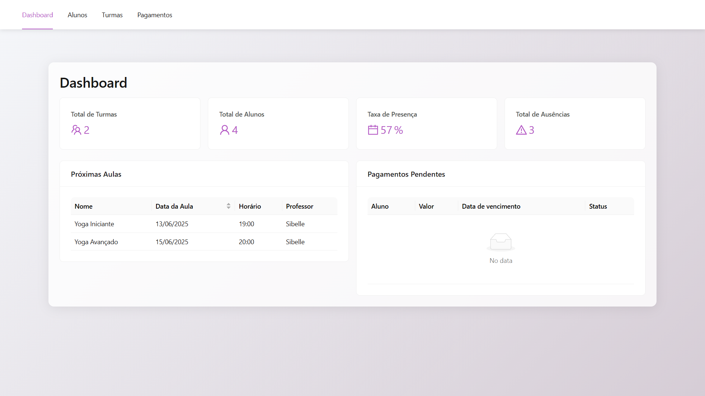
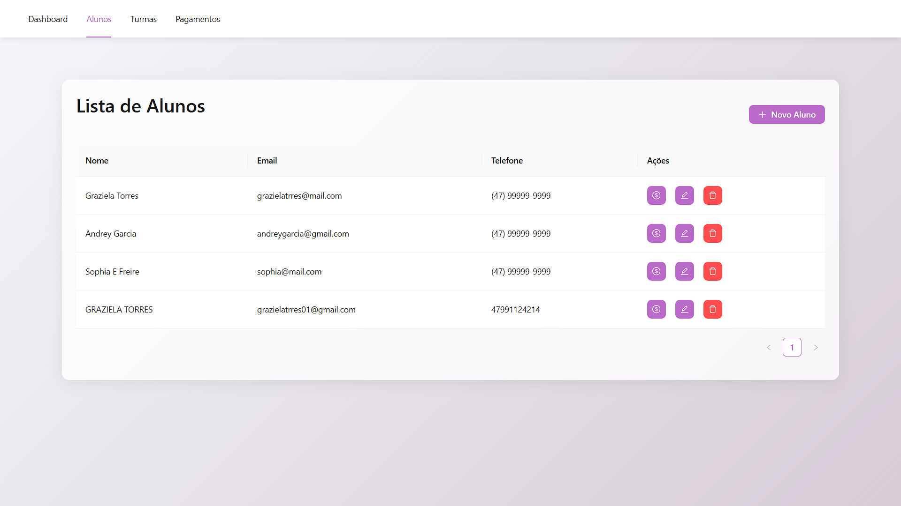
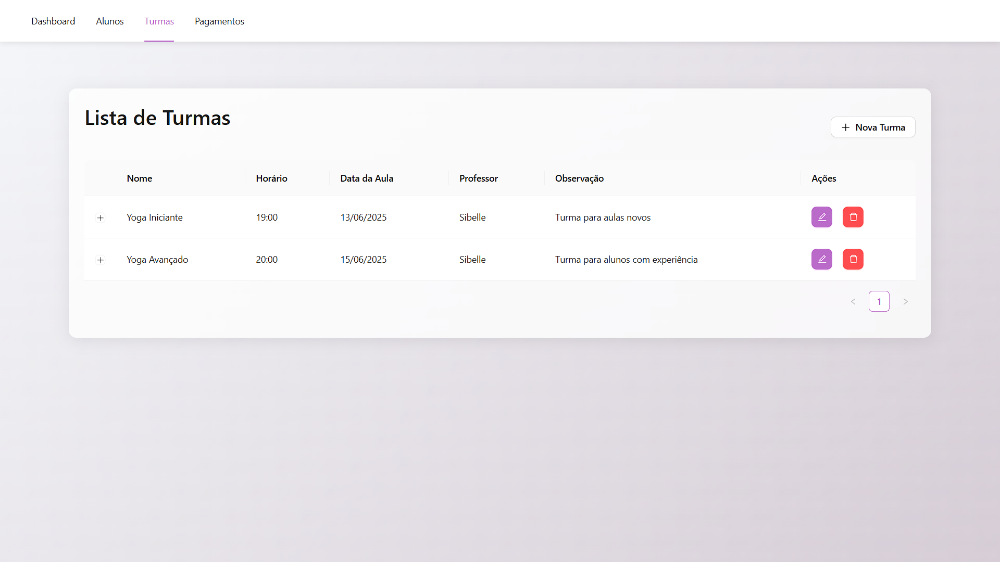
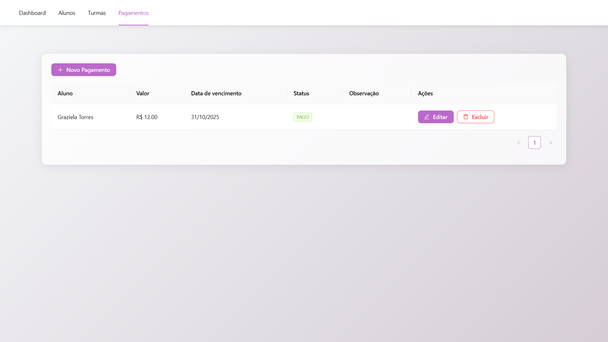
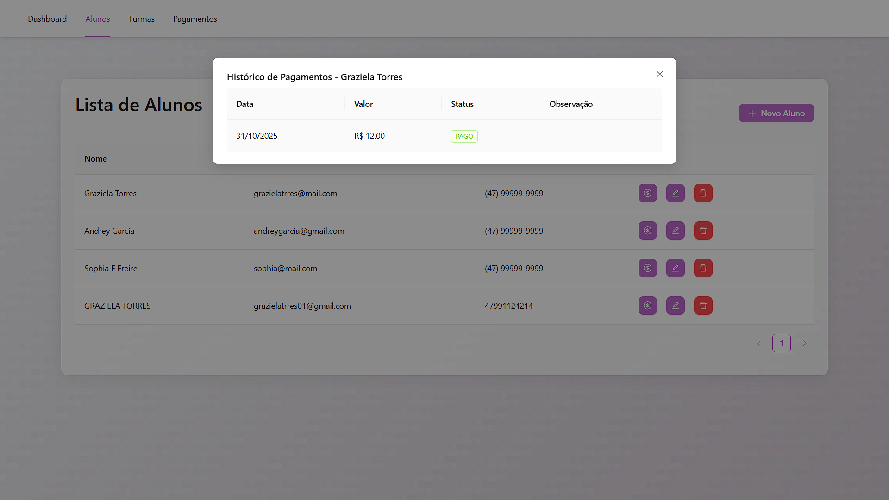

# Svabhava Planner - Sistema de Gerenciamento de Aulas de Yoga

## 📝 Sobre o Projeto

O Svabhava Planner é uma aplicação web moderna desenvolvida como parte do projeto de extensão acadêmica (PAC - Projeto de Aprendizagem Colaborativa Extensionista) do curso de Engenharia de Software no Centro Universitário Católica de Santa Catarina(Campus Joinville). O sistema foi projetado para facilitar o gerenciamento de aulas de yoga, tendo como caso de estudo as necessidades da instrutora Sibelle Eggert. A plataforma oferece uma solução completa para o gerenciamento de alunos, agendamentos e matrículas, demonstrando como o conhecimento acadêmico pode ser aplicado para beneficiar a comunidade.

## 📱 Descrição do App

O **Svabhava Planner** é um sistema web completo desenvolvido para gerenciar aulas de yoga de forma eficiente e organizada. A aplicação permite que instrutores de yoga controlem todos os aspectos do seu negócio através de uma interface moderna e intuitiva.

### Funcionalidades Principais:

- **Gestão de Alunos**: Cadastro completo de alunos com informações pessoais (nome, e-mail, telefone), histórico de participação e dados de contato organizados.

- **Gestão de Turmas**: Criação e organização de turmas com controle de vagas (máximo de 3 alunos por turma), agendamento de horários e datas, e visualização de agenda diária.

- **Controle de Presença**: Registro de presença e falta dos alunos em cada aula, com histórico completo de frequência individual.

- **Gestão Financeira**: Sistema completo de pagamentos que permite registrar pagamentos realizados, controlar pendências, visualizar histórico financeiro por aluno e identificar pagamentos atrasados no dashboard.

- **Dashboard e Estatísticas**: Visão geral com métricas importantes como número de turmas, quantidade de alunos, taxa de presença e indicadores de ausências, além de visualização de próximas aulas e pagamentos pendentes.

- **Interface Responsiva**: Design adaptável que funciona perfeitamente em desktops, tablets e smartphones, permitindo acesso de qualquer dispositivo.

A aplicação foi desenvolvida utilizando tecnologias modernas como React com TypeScript no frontend e Express.js com TypeORM no backend, garantindo uma experiência de usuário fluida e um sistema robusto e escalável.

#### Acadêmicos
- Andrey Garcia dos Santos
- Graziela Torres
- Sophia Eggert Freire da Rocha

### Professores orientadores

- Luiz Carlos Camargo
- Claudinei Dias

## Divisão de responsabilidades

- Sophia: Banco de dados, backend
- Andrey: Backend e frontend
- Graziela: Frontend, infraestrutura

## 🎯 Justificativa do PAC

Este projeto foi desenvolvido como parte do PAC (Projeto de Aprendizagem Colaborativa Extensionista) do curso de Engenharia de Software da Católica de Santa Catarina, tendo como entidade beneficiada a instrutora de yoga **Sibelle Eggert**.

A instrutora Sibelle Eggert enfrentava desafios significativos no gerenciamento manual de suas aulas de yoga, incluindo:
- Dificuldade em organizar e acompanhar o cadastro de alunos
- Controle manual de agendamentos e matrículas em turmas
- Ausência de um sistema centralizado para registro de presença
- Gestão financeira manual de pagamentos e pendências
- Falta de visibilidade sobre estatísticas e histórico de alunos

O Svabhava Planner foi desenvolvido para resolver essas necessidades, oferecendo uma solução tecnológica completa que:
- **Automatiza processos** que antes eram manuais e propensos a erros
- **Centraliza informações** de alunos, turmas, presenças e pagamentos em um único sistema
- **Facilita a gestão** com interface intuitiva e responsiva, acessível de qualquer dispositivo
- **Fornece insights** através de estatísticas e métricas que auxiliam na tomada de decisões
- **Organiza o histórico** de alunos, presenças e pagamentos de forma clara e acessível

Este projeto demonstra a aplicação prática do conhecimento acadêmico em benefício da comunidade, fortalecendo a relação entre universidade e sociedade através da extensão universitária.

## 💻 Requisitos do Sistema


### Requisitos Funcionais

RF1: O sistema deve permitir que a instrutora cadastre novos alunos com nome, e-mail e telefone.

RF2: O sistema deve permitir login e logout da instrutora com autenticação por e-mail e senha. *(Pendente - não implementado)*

RF3: O sistema deve permitir à instrutora criar, editar e excluir turmas com até 3 alunos, informando data, horário e lista de alunos inscritos.

RF4: O sistema deve exibir para a instrutora uma agenda diária com os horários das turmas e seus respectivos alunos.

RF5: O sistema deve permitir que a instrutora matricule alunos nas turmas com vagas disponíveis (máximo de 3 por turma).

RF6: O sistema deve permitir que a instrutora cancele a matrícula de alunos em turmas específicas.

RF7: O sistema deve apresentar à instrutora estatísticas como número de turmas, quantidade de alunos, taxa de ocupação e ausências.

RF8: O sistema deve permitir que a instrutora marque presença ou falta dos alunos em cada aula realizada.

RF9: O sistema deve exibir à instrutora o histórico de presença de cada aluno.

RF10: O sistema deve permitir à instrutora organizar e alterar os horários disponíveis para turmas.

RF11: O sistema deve permitir editar dados básicos dos alunos (nome, e-mail, telefone).

RF12: O sistema deve permitir registrar pagamentos feitos pelos alunos, valores pendentes e histórico financeiro individual.

RF13: O sistema deve alertar a instrutora sobre pendências de presença ou pagamentos atrasados dos alunos.

RF14: O sistema deve permitir que a instrutora cancele a matrícula de alunos.

### Requisitos Não Funcionais

RNF1: A interface deve se adaptar bem a diferentes tamanhos de tela, com prioridade para boa usabilidade em celulares e tablets.

RNF2: O sistema deve responder a qualquer ação do usuário em até 5 segundos.

RNF3: O sistema deve ser estruturado para crescer junto com o aumento de alunos e turmas, sem perda de desempenho.

RNF4: A interface deve ser clara, com fluxos simples e linguagem acessível à instrutora.

RNF5: O código deve seguir boas práticas (componentização, comentários, organização) para facilitar futuras manutenções e melhorias.

RNF6: O sistema deve permitir que a instrutora acesse de diferentes dispositivos ao mesmo tempo, sem conflitos de dados.

RNF7: O sistema deve funcionar corretamente nos principais navegadores: Chrome, Firefox, Safari e Edge.

RNF8: Deve evitar requisições desnecessárias, usar cache onde possível e carregar dados de forma eficiente.

RNF9: As senhas devem ser armazenadas de forma criptografada (ex: bcrypt) e o acesso ao sistema deve ser protegido por autenticação. *(Pendente - não implementado)*

RNF10: O sistema deve estar disponível para uso em pelo menos 99,9% do tempo, com mecanismos para evitar quedas.

RNF11: Deve haver backups automáticos e manuais dos dados críticos, como alunos, turmas, frequência e pagamentos.

RNF12: O sistema deve ser totalmente funcional em telas a partir de 320px de largura.

RNF13: O sistema deve gerar relatórios (PDF ou CSV) de turmas, alunos matriculados e frequência por período. *(Pendente - não implementado)*

RNF14: O sistema deve exibir mensagens de erro claras e compreensíveis para a instrutora em caso de falhas.

RNF15: O sistema deve exibir em formato de calendário ou lista todas as turmas do dia, com seus respectivos alunos e status de presença.


## 📊 Modelagem


## 🔧 Requisitos para Preparar o Ambiente de Desenvolvimento

### Pré-requisitos
- **Node.js** (versão 18 ou superior)
- **npm** (versão 9 ou superior) ou **yarn**
- **MySQL** (versão 8.0 ou superior)
- **Git** para clonar o repositório

### Instalação

1. **Clone o repositório**
```bash
git clone https://github.com/grazielatrres/svabhava-planner.git
cd svabhava-planner
```

2. **Configure o banco de dados MySQL**
   - Crie um banco de dados MySQL
   - Configure as variáveis de ambiente no backend (consulte `backend/env.example`)

3. **Instale as dependências do backend**
```bash
cd backend
npm install
```

4. **Instale as dependências do frontend**
```bash
cd ../frontend
npm install
```

5. **Configure as variáveis de ambiente**
   - Backend: Copie `backend/env.example` para `backend/.env` e configure as variáveis
   - Frontend: Copie `frontend/env.example` para `frontend/.env` e configure a URL da API

6. **Inicie o servidor backend**
```bash
npm run dev
```

7. **Em outro terminal, inicie o servidor frontend**
```bash
cd frontend
npm run dev
```

O sistema estará disponível em `http://localhost:5173` (frontend) e a API em `http://localhost:3001` (backend).

**Nota:** O banco de dados será criado automaticamente pelo TypeORM na primeira execução (synchronize: true). As tabelas serão geradas automaticamente com base nos modelos definidos.

## 🌐 Compatibilidade

O sistema é compatível com os seguintes navegadores:
- Google Chrome (última versão)
- Mozilla Firefox (última versão)
- Microsoft Edge (última versão)

## 📱 Responsividade

A aplicação é totalmente responsiva, adaptando-se aos seguintes dispositivos:
- Desktops
- Tablets
- Smartphones

## 📸 Telas do Sistema

### Dashboard

**Descrição:** Tela principal do sistema exibindo visão geral com estatísticas de alunos, turmas e informações resumidas para a instrutora.

### Gestão de Alunos

**Descrição:** Interface para cadastro, edição e visualização de alunos, permitindo gerenciar informações pessoais e histórico de cada aluno.

### Gestão de Turmas

**Descrição:** Tela para criação e gerenciamento de turmas, incluindo agendamento de horários, matrícula de alunos e controle de vagas disponíveis.

### Gestão de Pagamentos

**Descrição:** Interface para registro e acompanhamento de pagamentos, permitindo visualizar status financeiro de cada aluno e histórico de transações.

### Alunos e Pagamentos - Visão Integrada

**Descrição:** Visão integrada que permite acesso rápido às informações de alunos e seus respectivos pagamentos, facilitando a gestão financeira.

## 👥 Casos de Uso

### Autenticação e Segurança (Pendente)
- Sistema de login e logout
- Autenticação por e-mail e senha
- Criptografia de senhas
- Proteção de rotas

### Gestão de turmas
- Visualização das turmas cadastradas
- Inclusão/Edição de turmas
- Vincular alunos às turmas (até 3 alunos por turma)
- Registro de presença do aluno na turma
- Visualização de agenda com próximas aulas

### Gestão de pagamento
- Visualizar pagamentos
- Adicionar pagamentos pendentes, atrasados e pagos
- Editar pagamentos
- Remover alunos

### Gestão de alunos
- Adicionar novos alunos
- Editar alunos existentes
- Visualizar histórico de pagamento por aluno
- Remover alunos


## 🛠 Padrões de Desenvolvimento e tecnologias utilizadas

### Arquitetura
- **Clean Architecture (Backend)** - Separação clara de responsabilidades em controllers, repositories e models
- **Component-Based Architecture (Frontend)** - Estrutura baseada em componentes React com separação em pages e services

### Frontend
- **React com TypeScript** - Desenvolvimento com tipagem forte e componentes funcionais
- **Vite** - Build tool e servidor de desenvolvimento rápido
- **Ant Design** - UI components para interface consistente
- **Styled Components** - Estilização com CSS-in-JS
- **React Router DOM** - Roteamento da aplicação
- **Axios** - Cliente HTTP para comunicação com a API
- **dayjs** - Biblioteca para manipulação de datas

### Backend
- **Express.js** - Framework para construção da API REST
- **TypeORM** - ORM para gerenciamento de banco de dados
- **MySQL2** - Driver MySQL para Node.js
- **CORS** - Middleware para habilitar requisições cross-origin
- **dotenv** - Gerenciamento de variáveis de ambiente

### Padrões de Código
- **TypeScript** - Tipagem forte e verificação estática em ambos frontend e backend
- **ESLint** - Padronização de código no frontend
- **Decorators** - Uso de decorators para metadados e configuração (TypeORM)
- **Repository Pattern** - Separação da lógica de acesso a dados em repositórios

### API e Integração
- **REST Architecture** - Endpoints RESTful com separação clara de responsabilidades
- **Axios** - Cliente HTTP para comunicação com a API
- **CORS** - Configuração de segurança para requisições cross-origin

### Estrutura de Diretórios

#### Frontend
```
frontend/src/
├── assets/      # Recursos estáticos (imagens, ícones)
├── pages/       # Páginas da aplicação (Home, StudentList, TurmaList, PaymentList, etc.)
├── services/    # Serviços de API (alunoService, turmaService, paymentService, etc.)
├── App.tsx      # Componente principal da aplicação
├── main.tsx     # Ponto de entrada da aplicação
└── config.ts    # Configurações da aplicação
```

#### Backend
```
backend/src/
├── config/         # Configurações (database.ts, bd.ts)
├── controllers/    # Controladores da API (alunoController, turmaController, etc.)
├── models/         # Modelos de dados/entidades TypeORM (Aluno, Turma, Presenca, Pagamento)
├── repositories/   # Repositórios para acesso a dados
├── routes/         # Definição de rotas da API
└── app.ts          # Arquivo principal da aplicação Express
```

## 🗄️ Banco de Dados

### Tecnologia
- **MySQL** - Sistema de gerenciamento de banco de dados relacional (RDBMS)
- **TypeORM** - ORM para TypeScript/Node.js
- **Synchronize Mode** - O TypeORM está configurado com `synchronize: true`, criando automaticamente as tabelas baseadas nos modelos. Para ambientes de produção, é necessário configurar migrations.

### Modelo de Dados
O sistema utiliza um modelo relacional com as seguintes entidades principais:
- **Aluno**: Informações dos alunos (nome, email, telefone, endereço, observações)
- **Turma**: Turmas de yoga (nome, horário, data_aula, professor, observações)
- **Presenca**: Registro de presença/falta dos alunos nas turmas
- **Pagamento**: Registro de pagamentos (valor, data, status: pendente/atrasado/pago)

As relações são:
- Aluno possui múltiplas Presenças e Pagamentos
- Turma possui múltiplos Alunos (relação Many-to-Many) e múltiplas Presenças


## 📄 Licença
Este é um projeto acadêmico desenvolvido para fins educacionais e sociais como parte da disciplina de PROJETO DE APRENDIZAGEM COLABORATIVA EXTENSIONISTA (PAC) do curso de Engenharia de Software doCentro Universitário Católica de Santa Catarina(Campus Joinville). Todo o código e documentação foram criados com propósito de aprendizagem e contribuição para a comunidade, demonstrando a aplicação prática do conhecimento acadêmico em benefício da sociedade sem fins lucrativos.

© 2025 - Todos os direitos reservados

---

